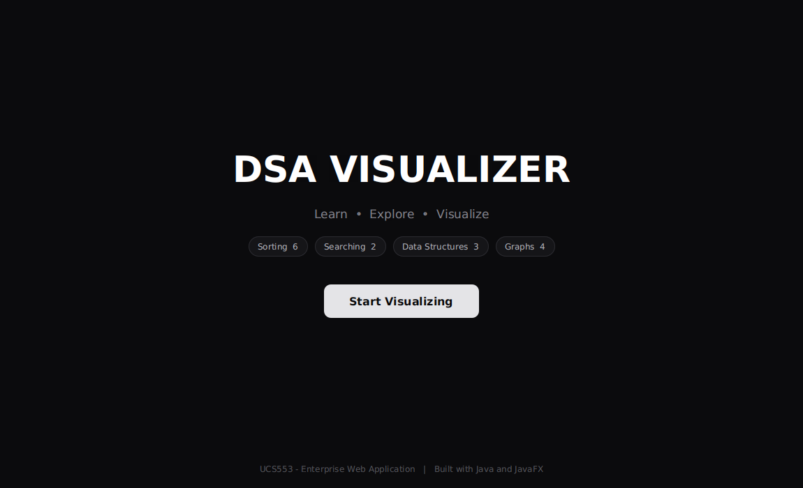
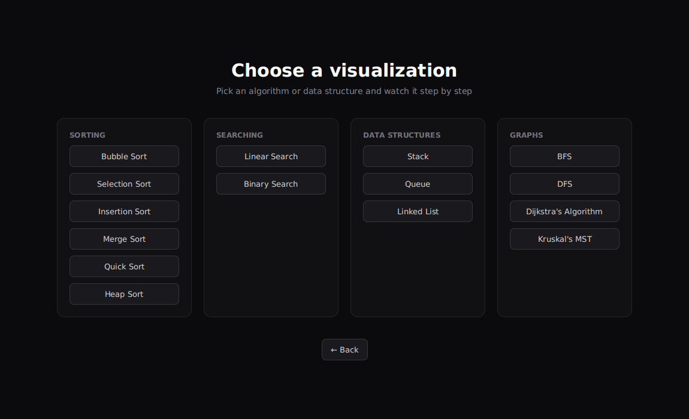
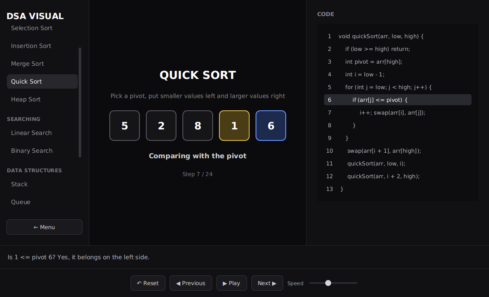
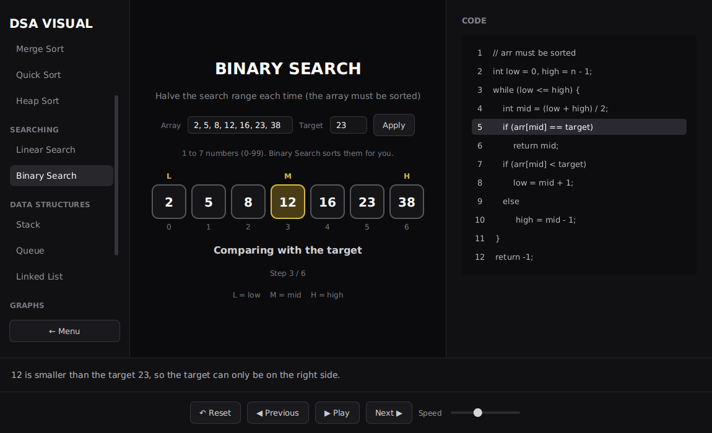
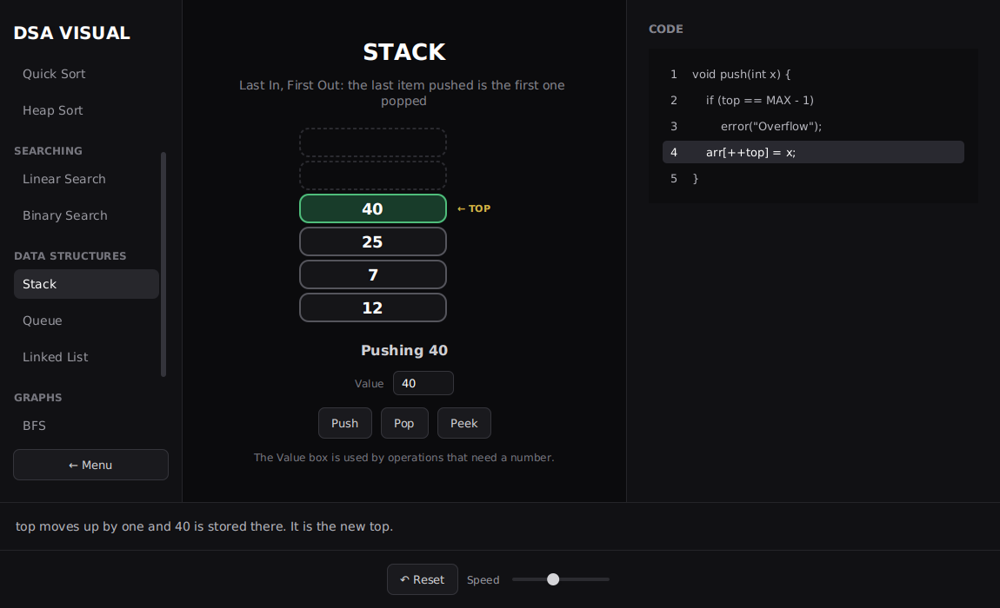
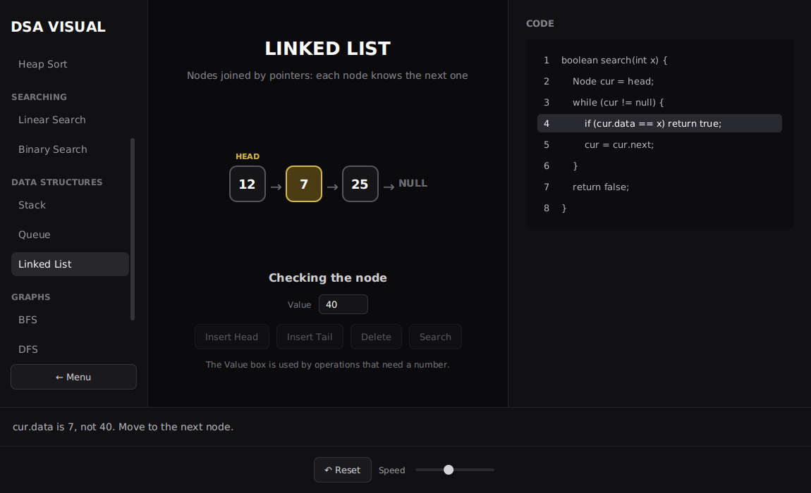
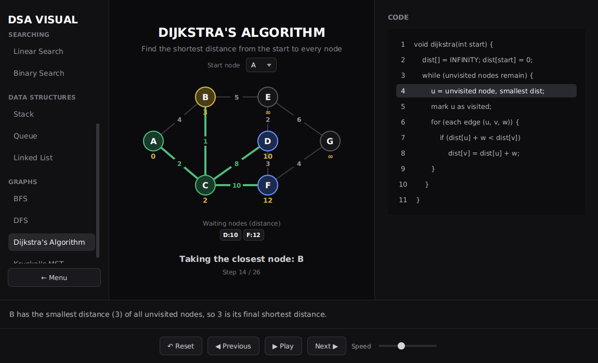
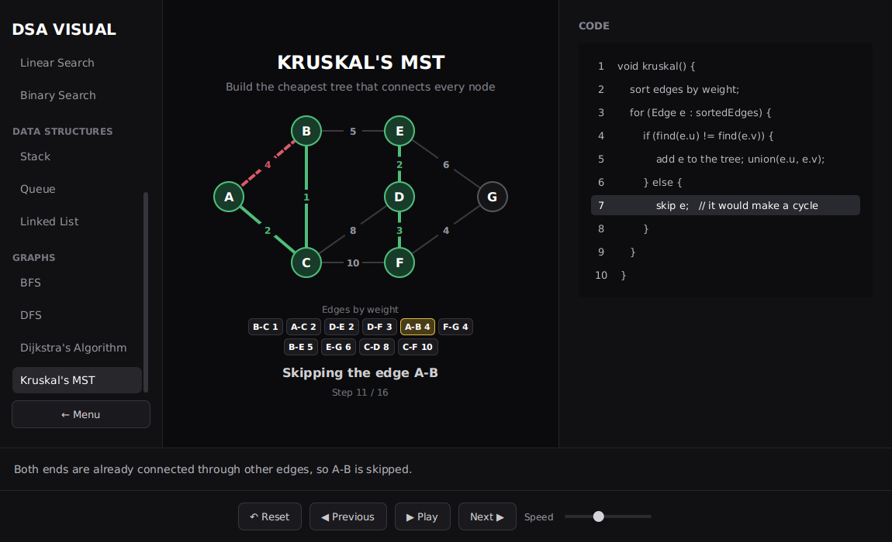

# DSA Visualizer

A desktop application that **shows how data structures and algorithms work, one step at a time**.
Pick an algorithm, press **Next** (or **Play**), and watch the array, the stack, the linked list or the
graph change while the matching line of pseudocode is highlighted and a plain-English explanation
tells you what just happened.

Course project for **UCS553: Enterprise Web Application** (Core Java + JavaFX).


> Authors:

- Nishika Gupta (Roll No. 1024031036)
- Kartik Gupta (Roll No. 1024031031)

| | |
|---|---|
|  |  |
|  |  |
|  |  |
|  |  |

---

## Features

- **15 visualizations** in four groups (see the table below).
- **Step-by-step control**: Next, Previous, Play / Pause, Reset and a speed slider.
- **Pseudocode panel**: the line being executed is highlighted.
- **Explanation bar**: every step says in words what is happening and why.
- **Colour code** that is the same everywhere:
  yellow = being looked at, blue = waiting / the key, red = swapping or not allowed,
  green = finished or found, dim = not part of the current work.
- **Your own input**:
  - Searching: type an array (1-7 numbers from 0-99) and a target, then press **Apply**.
  - Data structures: a **Value** box and operation buttons (Push, Pop, Enqueue, Insert, Delete ...).
  - Graph algorithms: choose the **start node** from a drop-down.
  - Sorting screens use a fixed example array (5, 2, 8, 1, 6).
- **Input validation**: wrong input (letters, too many numbers, Push on a full stack ...) shows a
  dialog and changes nothing.
- **Dark theme** with smooth fade transitions between screens.

## What is inside

| Group | Visualizations | What you can do |
|---|---|---|
| **Sorting** | Bubble, Selection, Insertion, Merge, Quick, Heap | Step through the sort on the example array 5, 2, 8, 1, 6. Cards slide when two values swap. |
| **Searching** | Linear Search, Binary Search | Type an array and a target, then watch the search narrow down. |
| **Data structures** | Stack, Queue, Linked List | Push / Pop / Peek, Enqueue / Dequeue / Peek, Insert Head / Insert Tail / Delete / Search. |
| **Graphs** | BFS, DFS, Dijkstra's shortest path, Kruskal's minimum spanning tree | Choose a start node and follow the algorithm on a 7-node weighted graph. |

### Time and space complexity

n = number of elements, V = nodes, E = edges.

| Algorithm | Time | Space | Note |
|---|---|---|---|
| Bubble Sort | O(n²) worst, O(n) best | O(1) | Stops early when a pass makes no swaps. |
| Selection Sort | O(n²) | O(1) | |
| Insertion Sort | O(n²) worst, O(n) best | O(1) | Fast on almost-sorted data. |
| Merge Sort | O(n log n) | O(n) | Needs extra space to merge. |
| Quick Sort | O(n log n) average, O(n²) worst | O(log n) | Pivot = last element. |
| Heap Sort | O(n log n) | O(1) | Builds a max heap first. |
| Linear Search | O(n) | O(1) | Works on any array. |
| Binary Search | O(log n) | O(1) | The array must be sorted (the app sorts it for you). |
| Stack: push / pop / peek | O(1) | O(n) | Last In, First Out. |
| Queue: enqueue / dequeue / peek | O(1) | O(n) | First In, First Out. |
| Linked List: insert head | O(1) | O(n) | |
| Linked List: insert tail / delete / search | O(n) | O(n) | Must walk the nodes from the head. |
| BFS | O(V + E) | O(V) | Uses a queue. |
| DFS | O(V + E) | O(V) | Uses recursion (the call stack). |
| Dijkstra | about O(V² log V) here | O(V) | This version re-sorts a list each round, which is easy to read. With a priority queue it is O((V + E) log V). |
| Kruskal | O(E log E) | O(V + E) | Dominated by sorting the edges. |

---

## Technologies

- **Java 25** (JDK 25)
- **JavaFX 25** (OpenJFX): Stage, Scene, layouts, controls, animations, CSS
- **Maven** for the build and the `javafx-maven-plugin`
- **IntelliJ IDEA** on Windows

No database and no external libraries other than JavaFX.

## How to run

**Requirements:** JDK 25 and Maven (IntelliJ already includes a Maven).

1. Open IntelliJ IDEA, choose **File → Open**, and select the folder that contains `pom.xml`.
2. Wait until Maven finishes loading (or press **Reload All Maven Projects** in the Maven panel).
3. Open the **Maven** panel on the right: **Plugins → javafx → javafx:run**.

The window opens on the dashboard. Click **Start Visualizing**, then pick an algorithm.

From a terminal (only if Maven is on your PATH): `mvn javafx:run`

## How to use the screens

**Sorting, searching and graphs** (play-by-step screens)

| Control | What it does |
|---|---|
| **Next / Previous** | Move one step forward or back. |
| **Play / Pause** | Run the steps automatically. |
| **Reset** | Go back to the start. |
| **Speed** slider | Time between steps while playing. |
| Left sidebar | Jump to any other algorithm. **← Menu** returns to the menu. |

**Data structures** (operation screens): type a number in **Value**, press an operation button, and the
steps of that operation play automatically. Operations that are not possible (for example Pop on an empty
stack) show a warning dialog instead.

---

## Project structure

```
Java Project
├── pom.xml
├── README.md
├── docs/screenshots/                 screenshots used in this README
└── src/main
    ├── resources/styles.css          the dark theme (buttons, scrollbars, slider, dialogs)
    └── java/com/dsavisualizer
        ├── Main.java                 starts the app, builds the window and the dashboard
        ├── algorithms/               the "brain": runs an algorithm and records snapshots
        │   ├── Algorithm.java            abstract base: name, subtitle, intro, pseudocode
        │   ├── SortAlgorithm / SearchAlgorithm / GraphAlgorithm   abstract children
        │   ├── BubbleSort, SelectionSort, InsertionSort, MergeSort, QuickSort, HeapSort
        │   ├── LinearSearch, BinarySearch
        │   ├── BreadthFirstSearch, DepthFirstSearch, DijkstraAlgorithm, KruskalAlgorithm
        │   ├── SortStep, SearchStep, GraphStep      one snapshot of an algorithm
        │   ├── Graph, Edge                          the example graph
        │   └── AlgorithmRegistry.java               the one list of everything in the app
        ├── structures/               stack, queue and linked list
        │   ├── DataStructure.java        abstract base
        │   ├── StackStructure, QueueStructure, LinkedListStructure
        │   ├── StructureStep.java        one snapshot of an operation
        │   └── StructureException.java   custom exception (overflow, underflow ...)
        ├── util/
        │   ├── InputParser.java          turns typed text into numbers and checks it
        │   └── InvalidInputException.java  custom exception for bad input
        └── view/                     the "face": everything you see on screen
            ├── VisualizerView.java       sorting screen (with the slide animation)
            ├── SearchView.java           searching screen
            ├── StructureView.java        data structure screen
            ├── GraphView.java            graph screen
            ├── AlgorithmSelectionView.java   the menu
            ├── Sidebar.java              left sidebar shared by all screens
            ├── Styles.java               helper methods for the dark theme
            ├── ScreenSwitcher.java       changes the screen with a fade
            ├── AppScreen.java            interface implemented by every screen
            └── Navigator.java            interface that lets a screen go back to the dashboard
```

## How it works

The most important idea: **the algorithm and the drawing are separate.**

```
 Algorithm class                              Screen (view)
 (e.g. QuickSort)                             (e.g. VisualizerView)

 getSteps(array) ── runs the sort ──►  List<SortStep>  ──►  shows step number "index"
   and records a snapshot after        (array copy, which     Next    : index + 1
   every interesting moment            cards are special,     Previous: index - 1
                                       code line, message)    Play    : Timeline calls Next
```

1. When you open a screen, the algorithm runs **once** on a copy of the data and returns a list of
   snapshots (`SortStep`, `SearchStep`, `GraphStep`).
2. The screen only **displays** one snapshot at a time. Next and Previous just change the index, so going
   backwards is always exact.
3. Data structures work the same way, but per operation: pressing **Push** runs the operation and returns the
   steps for that push, which are played with a `Timeline`.

**How the screens connect**

- `Main` creates the window and the dashboard. It implements `Navigator`, so any screen can send you back
  to the dashboard without knowing about `Main`.
- The menu and the sidebar build their buttons from `AlgorithmRegistry`, then open the right screen:
  `VisualizerView`, `SearchView`, `StructureView` or `GraphView`. All sorts share **one** screen; all searches
  share **one** screen, and so on.
- `ScreenSwitcher` replaces the root of the Scene and plays a `FadeTransition`.
- Every screen implements `AppScreen` (`createView()` and `stop()`), so the sidebar can stop a running
  timeline before it switches to another screen.

### Java and JavaFX concepts used

| Syllabus unit | Where it appears in the project |
|---|---|
| **Unit 1: OOP** | Abstract classes `Algorithm` → `SortAlgorithm` → `BubbleSort` (and the same for searching and graphs); abstract `DataStructure`; interfaces `Navigator` and `AppScreen`; polymorphism (a screen calls `getSteps()` on any `SortAlgorithm`); private fields with getters; `protected` constructors; **static** helper classes (`InputParser`, `Styles`, `ScreenSwitcher`) vs. **instance** classes (`SearchView`); packages; Maven project structure. |
| **Unit 2: exceptions, collections, generics** | Custom checked exceptions `InvalidInputException` and `StructureException`, caught with try / catch; `ArrayList`, `LinkedList` (used as a queue), `HashSet`, `Iterator` (walking the linked list), `Comparator` (sorting neighbours, waiting nodes and edges); generics such as `List<SortStep>`, `List<Integer>`; recursion (Merge, Quick, Heap sort and DFS). |
| **Unit 5: JavaFX** | `Application`, `Stage`, `Scene` and the Scene Graph; layouts `BorderPane`, `HBox`, `VBox` (and `Pane` for the graph); controls `Label`, `Button`, `TextField`, `ComboBox`, `Slider`, `ScrollPane`; event handlers written as lambdas (`setOnAction`); `Alert` dialogs and input validation; animation with `Timeline` / `KeyFrame`, `TranslateTransition` / `ParallelTransition` and `FadeTransition`; CSS styling. |

---

## How to add a new algorithm

1. **Create the class.** For example `ShellSort.java` in `algorithms/`, extending `SortAlgorithm`.
   Give the name, subtitle, intro and pseudocode in the constructor (`super(...)`), and write
   `getSteps(int[] array)` so it records a `SortStep` for every important moment.
2. **Register it.** Add one line to `AlgorithmRegistry.getSortAlgorithms()`:
   `list.add(new ShellSort());`
3. **Done.** The menu button and the sidebar button appear automatically, and the existing screen displays it.

Searching and graph algorithms work the same way (`SearchAlgorithm`, `GraphAlgorithm`).

## Manual test checklist

- [ ] The dashboard opens dark; **Start Visualizing** opens the menu with four cards.
- [ ] Every one of the 15 buttons opens its screen.
- [ ] On a sorting screen: Next, Previous, Play, Pause, Reset and the speed slider work; the cards turn green at the end.
- [ ] Binary Search: type an unsorted array, press **Apply**, and see it sorted.
- [ ] Typing `abc` as the target (or as a stack value) shows an error dialog and changes nothing.
- [ ] Stack: push until it is full, then push again, and see the Overflow warning. Pop on an empty stack shows Underflow.
- [ ] Graphs: change the start node in the drop-down and the run restarts from it.
- [ ] **← Menu** and **← Back** return to the menu and the dashboard.
- [ ] Resizing the window down to its minimum keeps the controls visible.

## Limitations and ideas for the future

- The array in the sorting screens is fixed (5, 2, 8, 1, 6) and the graph is a fixed 7-node example.
  Letting the user edit them would be the next step.
- Not included: Binary Search Tree and tree traversals, and Shell, Counting and other extra sorts.
- The project does not use a database or file storage.
